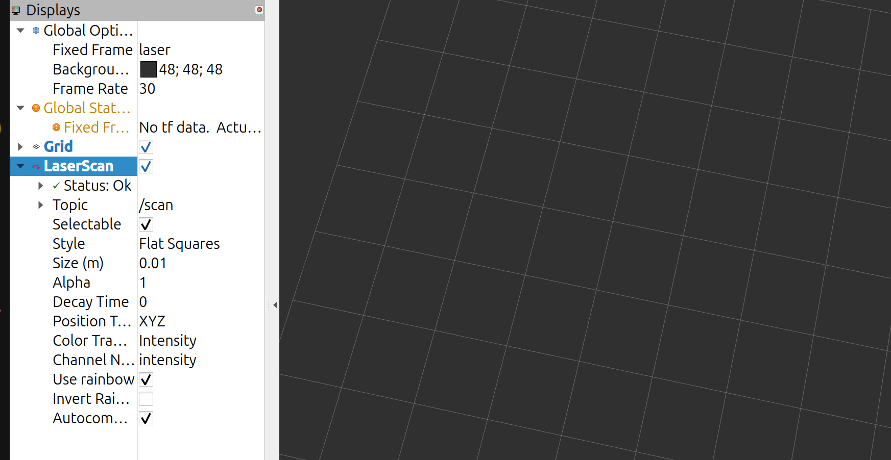

# robot_ws – Robot Hardware Layer

This workspace runs on the Wave Rover and turns the hardware into standard ROS 2
topics and transforms. Navigation in [`student_ws`](../student_ws/README.md)
depends on what this layer publishes.

```text
robot_init         - one launch file that starts everything below
waverover_base     - Wave Rover serial driver, wheel odometry, keyboard teleop
yesense_std_ros2   - Yesense IMU driver (gyro + absolute yaw)
rplidar_ros        - RPLIDAR 2D LiDAR driver
robot_model        - URDF (robot shape, sensor positions) + robot_state_publisher
serial             - serial-port library used by the IMU driver
yesense_interface  - message definitions for the Yesense driver
```

---

## How it works

```text
                     ros2 launch robot_init robot.launch.py
                                    │
     ┌──────────────────┬───────────┴──────────┬──────────────────────┐
     ▼                  ▼                      ▼                      ▼
 yesense_std_ros2    rplidar_ros          robot_model          waverover_base
 /dev/ttyACM0        LiDAR serial         URDF → TF tree       /dev/waverover (ESP32)
     │                  │                      │                      │
     ▼                  ▼                      ▼                      ▼
 /imu_data_ros        /scan            base_link → gyro_link     /cmd_vel  ──► motors
 (200 Hz)                              gyro_link → laser         /odom/raw ◄── wheel distances
                                                                 /waverover/imu, /battery
```

### `waverover_base` – motor driver and odometry

- **Commands:** subscribes to `/cmd_vel`, clamps it, multiplies the turn rate
  by `angular_command_gain` (3.0), caps it at `max_angular_vel` (3.0 rad/s),
  and sends it to the ESP32 as JSON `{"T":13,"X":v,"Z":w}`. A 20 Hz heartbeat
  resends the last command. If no `/cmd_vel` arrives for 0.8 s, it sends zero.
- **Feedback:** a background thread reads the ESP32's JSON feedback (100 Hz):
  left/right wheel distances, the built-in IMU's yaw and the battery voltage.
- **Odometry (`wheel_odometry.py`):** rebuilds position and heading from the
  signed left/right wheel distances:
  `forward = (dR + dL) / 2`, `heading change = (dR − dL) / wheel_track`.
  It publishes `/odom/raw` (no TF; the EKF in `student_ws` owns
  `odom → base_link`). It handles counter resets and smooths velocity over a
  50 ms window.
- **`keyboard_teleop`:** manual driving with WASD-style keys.

### `yesense_std_ros2` – IMU

Publishes `sensor_msgs/Imu` on `/imu_data_ros` in frame `gyro_link`.
Noise values in `config/yesense_config.yaml` tell the EKF to trust the gyro
for short-term turns and use absolute yaw to slowly correct drift. Extended
vendor topics are switched off to keep the 200 Hz stream light.

### `robot_model` – geometry and transforms

`urdf/diffbot.urdf.xacro` describes the measured robot (17 × 17 × 18 cm) and
where each sensor sits:

```text
base_link ─► imu_tracking (+5.0 cm up) ─► gyro_link (rolled 180°, IMU is mounted upside-down)
                                             └─► laser (+5.2 cm x, −4.0 cm z in gyro_link axes)
```

AMCL, the costmaps and Cartographer all use these transforms to place LiDAR
points, so their accuracy directly limits how precisely the robot can stop.

---

## Challenges and how they were overcome

| # | Challenge | What we found | How it was overcome |
| --- | --- | --- | --- |
| 1 | **Odometry reported rotation the robot was not doing** | The original driver published the *commanded* turn rate as measured `angular.z`, so the EKF believed every command was executed perfectly. | Removed it. Heading now comes from measured wheel distances and, in the EKF, from the Yesense IMU. |
| 2 | **Reversing looked like driving forward; spins looked like straight travel** | Firmware `dist_centre` only ever increased, and firmware `yaw_odom` barely moved during a real 90° spin (~0.8 rad over two turns). | Wrote `wheel_odometry.py` to rebuild distance and heading from the signed `dist_L`/`dist_R`. It has unit tests in `test/test_wheel_odometry.py`. |
| 3 | **Turns were under-measured** | Skid-steer wheels slide sideways when turning, so the physical wheel spacing (12.5 cm) gives the wrong heading change. | Calibrated an *effective* `wheel_track` of 0.391 m from a measured 90° spin (20 Oct). |
| 4 | **Jerky stop–go motion and weak turns** | The motors run open-loop PWM with a deadband. Small commands, such as a 0.5 rad/s turn (≈ PWM 16), do not move the robot, so it stalls and lurches. Measured turn rate was well below the commanded rate. | Tested commanded vs. measured turn rate, then added `angular_command_gain: 3.0` with an output cap of 3.0 rad/s (11 Nov). Turning response improved substantially. |
| 5 | **IMU readings had the wrong sign** | The Yesense IMU is mounted upside-down (forward-right-down axes), so an anticlockwise turn read as negative. | Added a 180° roll between `imu_tracking` and `gyro_link` in the URDF. Turns now read correctly after the EKF transforms them. |
| 6 | **Heading drifted ~5.6°/minute while stationary** | Residual gyro bias was being integrated. | Fused the Yesense absolute yaw alongside the gyro rate (tuned `orientation_stddev`). Drift settled to about 1–2° and stopped growing. |
| 7 | **Two IMUs, very different quality** | The Wave Rover's built-in IMU and the Yesense IMU disagreed. | Compared them and found the Yesense yaw far more accurate. It is now the heading source. The built-in IMU is still published on `/waverover/imu` for diagnostics. |
| 8 | **RViz footprint and costmaps did not match the real robot** | The URDF used a 0.30 × 0.25 m placeholder body. | Measured the robot (17 × 17 × 18 cm) and updated the URDF and Nav2 footprint (21 Oct). |
| 9 | **Persistent 5–10 cm stopping error** | The LiDAR offset from the IMU was entered as **−0.052 m** instead of **+0.052 m**, placing the LiDAR 10.4 cm from where it really is. Every scan was shifted, so AMCL's pose was shifted too. | Corrected `lidar_from_imu_x` to `+0.052` (11 Nov). This was **the single biggest accuracy improvement** of the project. |
| 10 | **Teleop drove go–stop–go** | The teleop sent zero after 0.5 s without a key event, which is shorter than the terminal's key-repeat delay. | Raised `key_timeout` to 1.2 s. |

### Known limitations

- The Yesense IMU occasionally fails to come online at start-up. Restarting
  `robot_init.sh` (or the driver) fixes it.
- Wheel speed is still open-loop PWM. True encoder-based wheel PID would need
  the matching ESP32 firmware source.

---

## Usage

### Build

```bash
cd ~/rb3302_final_proj_code/robot_ws
source /opt/ros/jazzy/setup.bash
colcon build --symlink-install
source install/setup.bash
```

### Start the robot

Keep this running while mapping or navigating:

```bash
~/rb3302_final_proj_code/robot_init.sh
# or: ros2 launch robot_init robot.launch.py
```

### Drive manually

```bash
source ~/rb3302_final_proj_code/robot_ws/install/setup.bash
ros2 run waverover_base keyboard_teleop
```

### Quick checks

```bash
ros2 topic hz /imu_data_ros     # IMU should be ~200 Hz
ros2 topic hz /scan             # LiDAR
ros2 topic echo /odom/raw       # wheel odometry
ros2 run tf2_tools view_frames  # TF tree: base_link → gyro_link → laser
```


