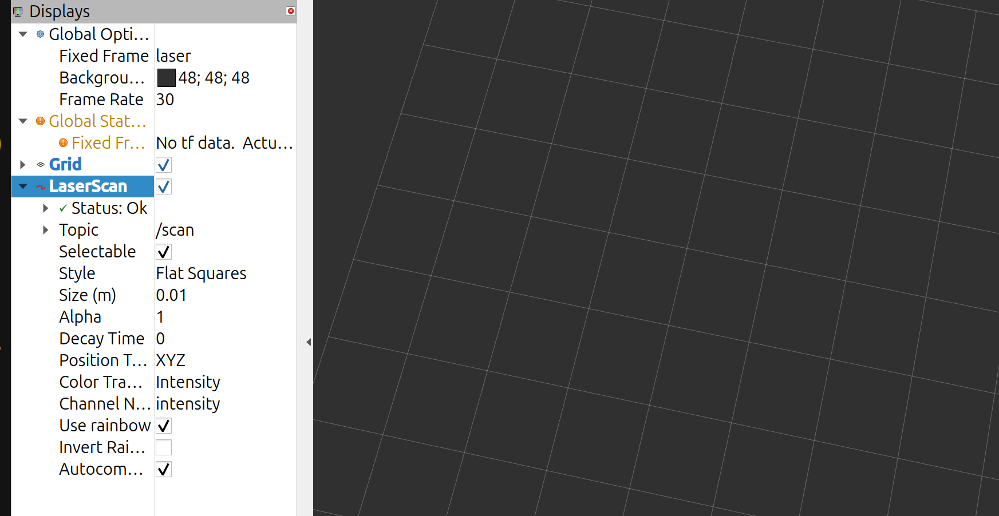

# student_ws – Mapping, Localisation and Navigation

This workspace turns the sensor data from [`robot_ws`](../robot_ws/README.md)
into a robot that can drive to four lettered cells (`A`–`X`) on the RB3302
course. It stops for three seconds at each cell, avoids obstacles that are not
on the map, and announces any cell it has to skip.

Both workspaces live in `~/rb3302_final_proj_code` on the robot.

```text
mapping_cartographer  - builds the course map with Cartographer (LiDAR SLAM)
planning_rpp          - the navigation stack used for the final project
planning_astar        - earlier A*-only navigation setup (kept for reference)
```

---

## How it works

```text
              robot_ws:  /scan (LiDAR)   /imu_data_ros   /odom/raw
                              │                │              │
                              │                ▼              ▼
                              │         robot_localization EKF
                              │         (wheel speed + IMU heading)
                              │                │  /odom, odom→base_link
                              ▼                ▼
      saved map ──►  AMCL (particle filter) ──► map→odom
                              │
                              ▼
  letter_waypoint*.py ──► Nav2 bt_navigator (custom behaviour tree)
                              │
                 ┌────────────┴─────────────┐
                 ▼                          ▼
          planner_server             controller_server
          NavFn with A*              Rotation Shim → Regulated Pure Pursuit
          (global path)              (turn to face path, then follow it)
                                            │
                                            ▼
                                   velocity_smoother ──► /cmd_vel ──► robot_ws driver
```

### 1. Mapping (`mapping_cartographer`)

Cartographer builds a 2D occupancy map from the LiDAR alone
(`use_odometry = false`, `use_imu_data = false`). A small node,
`scan_time_normalizer`, republishes `/scan` as `/scan_cartographer` with
corrected beam timestamps before Cartographer sees it. The finished map is
saved with `map_saver_cli` into `maps/rb3302_map.{yaml,pgm}`.

### 2. Localisation (`planning_rpp/launch/planning.launch.py`)

- **EKF (`robot_localization`)** fuses wheel forward speed from `/odom/raw`
  with the Yesense IMU's absolute yaw and yaw rate from `/imu_data_ros`. It
  publishes the smooth `odom → base_link` transform and `/odom`.
- **AMCL** matches LiDAR scans against the saved map and publishes
  `map → odom`, which corrects the drift that builds up in the EKF.
- **`initial_pose_nav_starter.py`** waits for the 2D Pose Estimate from RViz.
  It then forces a burst of AMCL updates so the pose snaps onto the walls
  before the robot moves, and starts the navigation lifecycle nodes.

### 3. Planning and control (`planning_rpp/config/nav2_params.yaml`)

- **Global planner:** NavFn with `use_astar: true`, which plans across the
  global costmap (static map + LiDAR obstacles + inflation).
- **Controller:** Rotation Shim wrapped around Regulated Pure Pursuit (RPP).
  The shim first turns the robot on the spot to face the path, then RPP
  follows it at up to 0.30 m/s, slowing near obstacles and corners.
- **Behaviour tree:** `config/no_global_clear.xml`. It replans at 1 Hz, keeps
  the current path while it is still valid, and on failure clears the local
  costmap, backs up and replans. Spin recovery is commented out.
- **Footprint:** 0.19 m × 0.19 m square (measured 0.17 m robot + 1 cm margin
  each side). Local inflation radius 0.40 m, cost scaling 3.0.

### 4. Mission (`planning_rpp/scripts`)

| Script | What it does |
| --- | --- |
| `letter_waypoint.py` | Sends four letters to Nav2 one at a time, waits 3 s at each, and announces and skips failed goals. |
| `letter_waypoint_precision.py` | **Used for the final runs.** Same as above, but stops Nav2 within 10 cm of the cell and finishes with small, collision-checked `Spin` and `DriveOnHeading` moves, checking AMCL between moves. A cell counts as reached only after the robot has been stopped for 1 s and five fresh AMCL poses all fall within 2 cm of the target and within 1 cm of each other. If the fine approach fails, the robot confirms it has stopped, announces the cell as missed and moves on. |
| `letter_waypoint_grid.py` | Experimental cell-to-cell route with stops at turns. Set aside. |
| `waypoint_accracy.py`, `yaw_diagnostic.py` | Measurement tools used while tuning. |

Cell coordinates for both waypoint scripts are in
`config/letter_coordinates.yaml`. They were sampled by placing the robot at
each of the 24 cell centres and reading its AMCL pose. Cells O, P and S–X
were re-sampled on 12 Nov after the URDF fix; earlier readings are kept as
comments next to each entry.

---

## Challenges and how they were overcome

| # | Challenge | What we found | How it was overcome |
| --- | --- | --- | --- |
| 1 | **Cartographer dropped part of every scan** | The RPLIDAR reports a scan duration longer than the real gap between scans, so Cartographer discarded the overlapping points. | Wrote `scan_time_normalizer`, which caps each scan's beam timing to the measured interval. |
| 2 | **Map distorted at loop closure** | Driving a new route back confused Cartographer's loop closure. | Remapped by retracing the same path back to the start (advice from the lab), and kept Cartographer on LiDAR only because wheel odometry was unreliable. |
| 3 | **Robot only spun on the spot** | With RPP's `use_rotate_to_heading: true`, the robot kept yawing slowly and never translated. The root cause was bad heading feedback (see `robot_ws`). | Turned it off (22 Sep) to get the first point-to-point drive. On 22 Oct, added the **Rotation Shim controller** to turn toward the path before RPP takes over. |
| 4 | **Heading drifted and turns were mis-measured** | The EKF used wheel-derived yaw rate, which was really the *commanded* value, and ignored the external IMU. | EKF now uses wheel forward speed only. Heading comes from the Yesense IMU (absolute yaw + yaw rate), which proved far more accurate than the Wave Rover's built-in IMU. |
| 5 | **Initial pose would not line up with the map** | AMCL only updates when the robot moves, so an RViz pose never snapped onto the walls while stationary. | `initial_pose_nav_starter.py` forces AMCL updates after each pose (increased from 8 to 20). Tuned `alpha1–5`, `update_min_d/a`, `sigma_hit` and up to 2000 particles. |
| 6 | **Stop–start driving** | Something was publishing zero velocity at ~36 Hz, fighting the controller's commands. It first looked like the behaviour server, but was most likely a node left over from an earlier run that had not shut down properly. Separately, motor deadband made small commands stall. | Added `kill.sh` to clear leftover ROS processes before every launch. Low-speed stalls were fixed in the driver (`robot_ws`). |
| 7 | **Turning too slowly / crashing into walls** | Shim output stayed at 0.2–0.3 rad/s although 0.5+ was requested. At 0.4 m/s, the robot moved faster than it could turn. | Set `closed_loop: true` and `max_angular_accel: 12.0`, raised smoother limits to 1.5 rad/s, added an angular gain in the driver, and settled on 0.30 m/s. |
| 8 | **Replanning forgot obstacles** | The default behaviour tree cleared the global costmap on every replan, so the robot kept re-choosing the blocked path. | Custom `no_global_clear.xml` that keeps the global costmap and only clears the local one. |
| 9 | **Controller fell from 20 Hz to ~1 Hz, EKF from 50 Hz to ~17 Hz, TF extrapolation errors** | Turning obstacle clearing off left stale obstacles; costmap work and constant replanning overloaded the onboard computer. | Restored `clearing: true`, reduced costmap overhead, and made the tree force a replan instead of looping on an unusable path. Raised `transform_tolerance`. EKF returned to ~50 Hz and the controller to ~20 Hz. |
| 10 | **Cutting corners near obstacles** | Path hugged inflated edges. | Inflation radius 0.40 m with `cost_scaling_factor: 3.0`, matched in RPP's cost-regulated speed. |
| 11 | **Whole stack crashed on a typo** | An integer given where Nav2 expects a double (e.g. `1` instead of `1.0`) makes the node fail to start. | All float parameters written with a decimal point. |
| 12 | **Poor final approach** | At low speed the wheels slip, and RPP alone stopped several centimetres off-centre. A single AMCL reading could also report arrival while the pose was still shifting. | `letter_waypoint_precision.py`: hand over from Nav2 near the cell to short `Spin`/`DriveOnHeading` moves, with AMCL refreshes, an oscillation guard and a bounded number of attempts. Arrival needs five stable AMCL poses taken while stopped. A failed fine approach now skips the cell instead of ending the mission. |
| 13 | **5–10 cm residual positioning error** | Calibrating all 24 cell centres helped only slightly, which pointed to a deeper error. | Traced to a sign error in the LiDAR mounting offset in the URDF (`robot_ws`). Fixing it was **the decisive improvement**. |
| 14 | **Ctrl+C on the mission crashed Nav2; failures ended the run** | The script exited without cancelling its goal. | Mission scripts now cancel goals on Ctrl+C/SIGTERM, count down 3 s at each stop, announce a missed cell, and move on to the next one. |

### Known limitations

- Spin recovery sometimes turned the wrong way, so it is disabled. Recovery
  uses back-up + replan.
- Obstacles not on the map that have gaps in them can still be planned
  through. The robot then relies on recovery.
- Final accuracy is confirmed by testing, but has not been measured as a number.
- Older copies (`nav2_params_original.yaml`, `planning.launch_original.py`,
  `planning.launch__.py`) are kept for reference and are not used.

---

## Usage

### Build

```bash
cd ~/rb3302_final_proj_code/student_ws
source /opt/ros/jazzy/setup.bash
source ~/rb3302_final_proj_code/robot_ws/install/setup.bash
colcon build --symlink-install
source install/setup.bash
```

Start the robot first (see [`robot_ws`](../robot_ws/README.md)):

```bash
~/rb3302_final_proj_code/robot_init.sh
```



### Mapping with Cartographer

```bash
ros2 launch mapping_cartographer mapping.launch.py
```

Drive slowly with teleop and return along the same route for a clean loop
closure. Keep mapping running, then in another terminal:

```bash
mkdir -p ~/rb3302_final_proj_code/student_ws/maps
ros2 run nav2_map_server map_saver_cli -f ~/rb3302_final_proj_code/student_ws/maps/rb3302_map
```

Do not run the navigation EKF at the same time as mapping, because both
publish `odom → base_link`.

If the map changes, re-sample the cell centres in
`src/planning_rpp/config/letter_coordinates.yaml`.

### Navigation (RPP)

```bash
~/rb3302_final_proj_code/rpp.sh      # or: ros2 launch planning_rpp planning.launch.py
~/rb3302_final_proj_code/nav_rviz.sh # on the laptop: RViz with the navigation layout
```

In RViz, set the robot's pose with **2D Pose Estimate**, then run a mission:

```bash
ros2 run planning_rpp letter_waypoint_precision.py A H Q X
```

`Ctrl+C` cancels the mission cleanly. If anything crashes, run
`~/rb3302_final_proj_code/kill.sh` before relaunching.

To record a run for debugging, start this in another terminal before the
mission and press `Ctrl+C` after the last cell:

```bash
~/rb3302_final_proj_code/record_debug.sh 01   # run number 01–99
```

It saves a bag to `~/rb3302_final_proj_code/rosbags/<run>-DD-MM-YY` with TF,
odometry, AMCL pose, the plan, velocity commands, Nav2 goal status and
`/rosout`. Earlier debug bags are in the same `rosbags/` folder.

### Navigation (A*, reference only)

```bash
ros2 launch planning_astar planning.launch.py
```
