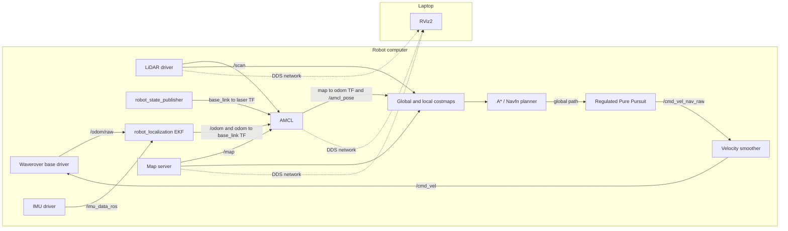
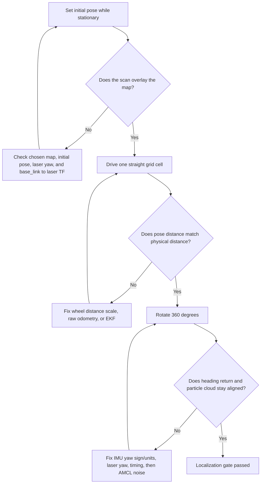
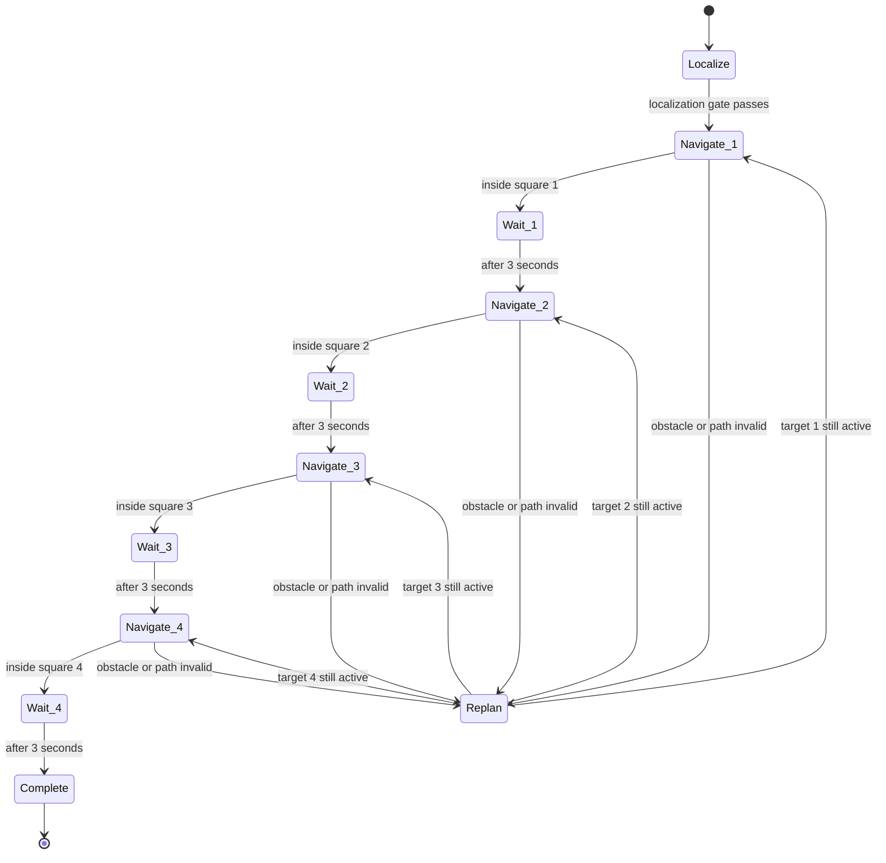

# RB3302 Navigation Implementation Roadmap

This roadmap updates the existing phased plan using the two runs in
`run_logs_sept08.zip`. It keeps the current repository architecture: the robot
workspace provides the hardware, transforms, and odometry; `planning_rpp`
provides localization, A* planning, Regulated Pure Pursuit (RPP), costmaps, and
waypoint execution.

The objective is not merely to make Nav2 report `active`. The robot must prove,
in order, that it can estimate its motion, stay localized, represent its true
body size, stop safely, and only then execute the four-square course.

> Provenance note: although the archive is named `run_logs_sept08.zip`, its two
> launch directories and ROS timestamps correspond to 6 June 2026 in Singapore
> time (5 June UTC). Confirm that these are the intended runs. Also synchronize
> the laptop and robot clocks before testing because RViz supplies a timestamped
> initial pose and both runs contain a small TF future-extrapolation warning.

## What the logs establish

| Evidence | Earlier run | Later run | Interpretation |
| --- | --- | --- | --- |
| Map loaded | `rb3302_map.yaml`, 108 x 87 at 0.05 m/cell | `pgpr_map.yaml`, 68 x 86 at 0.05 m/cell | The `map:=...` launch argument works in the later run. Map loading is no longer the blocker. |
| RViz on robot | Process exited with code `-6` | RViz was not launched | Keep `rviz:=false` on the robot and run RViz on the laptop. |
| Lifecycle | Localization and navigation nodes became active | Localization and navigation nodes became active | The nodes are not stuck unconfigured. Navigation activation waits for `map -> base_link`, which appears only after an initial pose. |
| Initial pose | Set to `(2.895, 0.192, -1.384)` | Set to `(0.073, -0.014, -0.041)` | AMCL accepted both poses, but each produced a small future-extrapolation warning (about 21 ms and 8 ms). |
| Goal | About 0.98 m away; then preempted | About 0.39 m away | Both goals reached the controller, and RPP received new paths. |
| Controller result | `Failed to make progress` after 10 s | `Failed to make progress` after 10 s | The controller did not observe the required change in robot pose. This is the primary failure to diagnose. |
| Control loop | One 16.16 Hz cycle after recovery | One 7.09 Hz cycle after recovery | A performance warning exists, but a single late recovery cycle does not explain the identical 10 s failures. |
| Waypoint task | Pause duration zero | Pause duration zero | The required three-second stop is not implemented yet. |

The planning logs do **not** include `/odom/raw`, `/odom`, `/cmd_vel`, wheel
telemetry, `/scan`, `/tf`, or `/amcl_pose` samples. Therefore they cannot tell us
which of these three cases occurred:

1. RPP produced no useful velocity because the path/costmap rejected motion.
2. `/cmd_vel` was published but the base did not execute it.
3. The robot moved physically but odometry/AMCL did not report enough movement.

The next run must be a rosbag, not only text logs, so these cases become
distinguishable.

## Current data flow



## Phase gates

Do not skip a failed gate. RPP tuning cannot repair incorrect odometry, and a
larger AMCL particle count cannot repair a reversed laser transform.

```mermaid
flowchart TD
    P0[Phase 0: reproducible launch and recording] --> G0{Correct map, nodes active, bag recording?}
    G0 -- No --> P0
    G0 -- Yes --> P1[Phase 1: base, odometry, IMU, and laser]
    P1 --> G1{Measured motion agrees with sensors?}
    G1 -- No --> P1
    G1 -- Yes --> P2[Phase 2: map quality]
    P2 --> G2{Stationary scan overlays crisp map walls?}
    G2 -- No --> P2
    G2 -- Yes --> P3[Phase 3: AMCL convergence]
    P3 --> G3{Pose remains stable through straight and turn tests?}
    G3 -- No --> P3
    G3 -- Yes --> P4[Phase 4: footprint and obstacle safety]
    P4 --> G4{Robot stops and clears obstacles with margin?}
    G4 -- No --> P4
    G4 -- Yes --> P5[Phase 5: RPP point-to-point tuning]
    P5 --> G5{Ten single goals succeed without contact?}
    G5 -- No --> P5
    G5 -- Yes --> P6[Phase 6: four-square mission]
    P6 --> G6{Correct order and three-second stops?}
    G6 -- No --> P6
    G6 -- Yes --> P7[Phase 7: timed validation]
```



## Phase 0 — Make every run reproducible

**Goal:** Prove which source, map, parameters, and topics are active, and record
enough data to diagnose a failure afterward.

1. Build the source workspaces after edits. Edit files under `src`, never under
   `build` or `install`.
2. Start only `robot_init` and `planning_rpp`. Do not launch `planning_astar` at
   the same time because `planning_rpp` already starts the Navfn A* planner.
3. Disable robot-side RViz. The earlier log proves it crashed; the later run
   without it shut down cleanly.
4. Pass the map explicitly and verify the live map-server parameter.

```bash
cd ~/rb3302_final_proj_code/robot_ws
colcon build --symlink-install
source install/setup.bash
ros2 launch robot_init robot.launch.py
```

In a second robot terminal:

```bash
source /opt/ros/jazzy/setup.bash
source ~/rb3302_final_proj_code/robot_ws/install/setup.bash
cd ~/rb3302_final_proj_code/student_ws
colcon build --symlink-install
source install/setup.bash
ros2 launch planning_rpp planning.launch.py map:=/home/ubuntu/rb3302_final_proj_code/student_ws/maps/pgpr_map.yaml rviz:=false
```

Verify the running system:

```bash
ros2 param get /map_server yaml_filename
ros2 lifecycle get /map_server
ros2 lifecycle get /amcl
ros2 lifecycle get /controller_server
ros2 topic hz /scan
ros2 topic hz /odom/raw
ros2 topic hz /odom
ros2 topic hz /cmd_vel
```

The map YAML and PGM must stay in the same directory when the YAML uses a
relative image name such as `image: pgpr_map.pgm`.

Record every motion test:

```bash
mkdir -p ~/rb3302_final_proj_code/bags
ros2 bag record -o ~/rb3302_final_proj_code/bags/nav_test /scan /odom/raw /odom /imu_data_ros /tf /tf_static /amcl_pose /particle_cloud /map /plan /cmd_vel_nav_raw /cmd_vel /local_costmap/costmap /global_costmap/costmap /diagnostics
```

Use a new output name for each run. Also save the launch command, current Git
commit, changed-file list, and parameter dump beside the bag.

**Exit gate:** the requested map path is printed by the launch file and returned
by `/map_server`; localization and navigation nodes are `active` after the
initial pose; the bag contains scan, both odometry topics, both velocity topics,
TF, and AMCL data.

## Phase 1 — Prove the motion sensors before AMCL

**Goal:** Determine whether the repeated `Failed to make progress` error is
caused by the command chain, base driver, wheel-distance scale, odometry, IMU,
or TF.

Keep Nav2 goals disabled and perform three low-speed, measured tests with a clear
floor and an emergency-stop operator:

1. **Command-chain test:** publish a short forward command and confirm values
   appear in `/cmd_vel`, reach the driver, and then return to zero.
2. **One-metre test:** mark the floor, drive exactly 1.00 m, and compare physical
   distance with the deltas in `/odom/raw` and `/odom`.
3. **Rotation test:** rotate exactly 360 degrees and compare the final yaw in the
   base telemetry, IMU, `/odom/raw`, and `/odom`.
4. **Laser orientation test:** place one object directly in front of the robot.
   It must appear in front of `base_link` in RViz. The URDF currently defaults
   `laser_yaw` to pi, so this test is mandatory rather than assuming the mount
   direction.
5. Check that there is exactly one `odom -> base_link` publisher. The intended
   owner is the EKF; the base driver currently has `publish_odom_tf: false`.

Suggested acceptance limits for the first pass:

- 1.00 m physical travel gives 0.95–1.05 m in `/odom/raw` and `/odom`.
- A 360-degree turn returns within 5 degrees of the starting yaw.
- `odom -> base_link` changes smoothly while the robot moves and stops changing
  when it stops.
- The front-object scan is on the positive-x side of `base_link`.
- `/cmd_vel_nav_raw` and `/cmd_vel` are nonzero during commanded motion.

If the physical robot moves but `/odom` does not, fix the base odometry/EKF path
before changing AMCL or the progress checker. If `/cmd_vel_nav_raw` is nonzero
but `/cmd_vel` is zero, inspect the velocity smoother. If both are nonzero but
the robot does not move, inspect the base driver and hardware link.

**Exit gate:** all four sensor tests pass in a recorded bag.

## Phase 2 — Accept or rebuild the map

**Goal:** Use a map whose geometry agrees with the live laser. Changing maps
changes the coordinate system, so old initial poses and waypoint coordinates
must not be reused blindly.

For each candidate map:

1. Set the initial pose while stationary.
2. In laptop RViz, display Map, LaserScan, RobotModel, TF, and AMCL pose.
3. Check at several known positions that live scan endpoints sit on map walls.
4. Reject maps with doubled walls, curved straight walls, discontinuities, or an
   incorrect scale.
5. If rebuilding, first use the Phase 1-calibrated odometry and IMU. The current
   Cartographer config disables both odometry and IMU input; enable them only
   after their signs, units, timestamps, and covariances are known to be valid.

The later log proves `pgpr_map.yaml` loads correctly; it does not prove that the
68 x 86 map matches the physical course.

**Exit gate:** scan-to-map alignment is visually correct at the start and at
multiple locations, with no systematic rotation, translation, or scale error.

## Phase 3 — Make AMCL converge and remain converged

**Goal:** Obtain a stable `map -> odom` correction while the robot is stationary,
moves one grid cell, and rotates.

The current AMCL motion-noise values `alpha1` through `alpha5` are all `0.8`.
That injects a large amount of uncertainty on every motion update. Use `0.2` as
a conservative starting baseline, then tune from bags rather than appearance
alone:

```yaml
amcl:
  ros__parameters:
    alpha1: 0.2
    alpha2: 0.2
    alpha3: 0.2
    alpha4: 0.2
    alpha5: 0.2
    min_particles: 500
    max_particles: 2000
    update_min_d: 0.05
    update_min_a: 0.05
    laser_model_type: likelihood_field
```

After setting the initial pose, rotate slowly in place to provide varied laser
observations. Judge convergence using all three of these signals:

- scan endpoints align with the map;
- `/amcl_pose` covariance decreases and remains bounded;
- `map -> base_link` follows physical motion without jumps or drift.

The future-extrapolation warnings in both logs are small, but repeated TF drops
must be fixed by checking clock synchronization and timestamp latency. Do not
hide a persistent timing defect by increasing transform tolerance indefinitely.



**Exit gate:** three consecutive start-localize-drive-turn trials remain aligned;
pose jumps are less than 0.10 m and 5 degrees after stopping, unless measurements
justify a different threshold.

## Phase 4 — Make the costmaps represent the real robot

**Goal:** Prevent the planner and controller from accepting a path that the
physical chassis cannot clear.

Both RPP costmaps currently describe a 0.05 x 0.05 m footprint, while the URDF
chassis is 0.30 x 0.25 m. This can directly permit collisions. Measure the full
moving envelope, including wheels, caster, wiring, and protrusions. With only
the URDF dimensions available, a provisional 20 mm margin is:

```yaml
footprint: "[[-0.17, -0.145], [0.17, -0.145], [0.17, 0.145], [-0.17, 0.145]]"
```

Apply the same measured footprint to both:

- `local_costmap.local_costmap.ros__parameters.footprint`
- `global_costmap.global_costmap.ros__parameters.footprint`

Then set explicit obstacle and inflation parameters. Start cautiously and tune
against measured clearance:

```yaml
inflation_layer:
  plugin: nav2_costmap_2d::InflationLayer
  inflation_radius: 0.25
  cost_scaling_factor: 4.0
```

Test with a removable box at increasing distances. Confirm the obstacle appears
in the local costmap, the global path avoids it, and the robot stops before its
physical body reaches it. Keep an operator ready to stop the base.

**Exit gate:** ten low-speed approaches and replans complete without contact,
with a measured safety margin.

## Phase 5 — Tune RPP for one point-to-point goal

**Goal:** Navigate reliably between adjacent square centres before attempting a
mission.

The current RPP configuration requests 0.30 m/s with a fixed 0.60 m lookahead,
which is approximately one course grid cell. Start slower with a shorter,
velocity-scaled lookahead and stronger collision/cost regulation:

```yaml
controller_server:
  ros__parameters:
    progress_checker:
      plugin: nav2_controller::SimpleProgressChecker
      required_movement_radius: 0.05
      movement_time_allowance: 20.0
    goal_checker:
      plugin: nav2_controller::SimpleGoalChecker
      xy_goal_tolerance: 0.10
      yaw_goal_tolerance: 0.15
    FollowPath:
      desired_linear_vel: 0.12
      lookahead_dist: 0.20
      min_lookahead_dist: 0.15
      max_lookahead_dist: 0.35
      lookahead_time: 1.0
      use_velocity_scaled_lookahead_dist: true
      use_collision_detection: true
      max_allowed_time_to_collision_up_to_carrot: 2.0
      use_regulated_linear_velocity_scaling: true
      use_cost_regulated_linear_velocity_scaling: true
      rotate_to_heading_angular_vel: 0.35
```

Only relax the progress checker after Phase 1 proves that odometry moves. The
identical 10-second failures in both logs match the current default progress
window; increasing the timeout before fixing odometry would only delay the same
failure.

Test adjacent-square forward motion, 90-degree turns, diagonal paths, and a
single blocked route. Change one parameter group per bag. Raise speed only after
ten consecutive collision-free successes.

**Exit gate:** ten consecutive single-goal trials finish without `Failed to make
progress`, localization loss, contact, or operator intervention.

## Phase 6 — Implement the four-square mission

**Goal:** Convert the ordered square labels into map-frame poses, visit them in
order, stop inside each square, and wait three seconds.

Set the existing waypoint task executor to the required pause:

```yaml
waypoint_follower:
  ros__parameters:
    stop_on_failure: true
    waypoint_task_executor_plugin: wait_at_waypoint
    wait_at_waypoint:
      plugin: nav2_waypoint_follower::WaitAtWaypoint
      enabled: true
      waypoint_pause_duration: 3000
```

Create one table that maps labels A–X to measured map-frame centre coordinates.
Generate that table from a surveyed grid origin, row/column direction, and 0.60 m
spacing instead of clicking approximate goals every run. A new map requires the
table to be regenerated or transformed.



The mission controller should log target label, target pose, start time, result,
final pose error, pause start/end, missed waypoint, and total elapsed time.

**Exit gate:** the robot visits four commanded squares in order, remains within
each square, visibly stops for at least three seconds, and safely replans around
a blocked square.

## Phase 7 — Timed course validation

**Goal:** Demonstrate repeatability under assessment conditions rather than one
successful run.

Run at least five complete courses with different starting squares, bearings,
goal orders, and obstacle placements. For every run retain the rosbag, text logs,
map checksum, parameter file, Git commit, and a result sheet.

Pass criteria:

- correct map and initial pose;
- all four targets reached in order;
- robot body contained in each target square and covering the label;
- pause of at least three seconds at each target;
- no contact with walls or obstacle;
- no AMCL jump or loss of `map -> odom`;
- total mission time below three minutes;
- no manual intervention after mission start.

## Immediate next action

Do **Phase 1**, not more RPP tuning. The present evidence ends at the controller:
it shows that a path was repeatedly delivered and then rejected for lack of
progress, but it does not contain the signals needed to identify the broken link.
A bag containing commands, raw/filtered odometry, TF, scan, and AMCL pose will
turn the next failure into a specific fix.

## Relevant repository files

- `student_ws/src/planning_rpp/launch/planning.launch.py` — launch arguments,
  EKF, Nav2 nodes, remappings, and robot-side RViz switch.
- `student_ws/src/planning_rpp/config/nav2_params.yaml` — AMCL, RPP, progress and
  goal checkers, costmaps, footprint, and waypoint executor.
- `robot_ws/src/waverover_base/waverover_base/waverover_driver.py` — base command
  handling and raw odometry generation.
- `robot_ws/src/waverover_base/launch/driver.launch.py` — `/odom/raw` and odometry
  TF ownership.
- `robot_ws/src/robot_model/urdf/diffbot.urdf.xacro` — chassis dimensions and
  laser transform.
- `student_ws/src/mapping_cartographer/config/cartographer.lua` — mapping sensor
  inputs.
